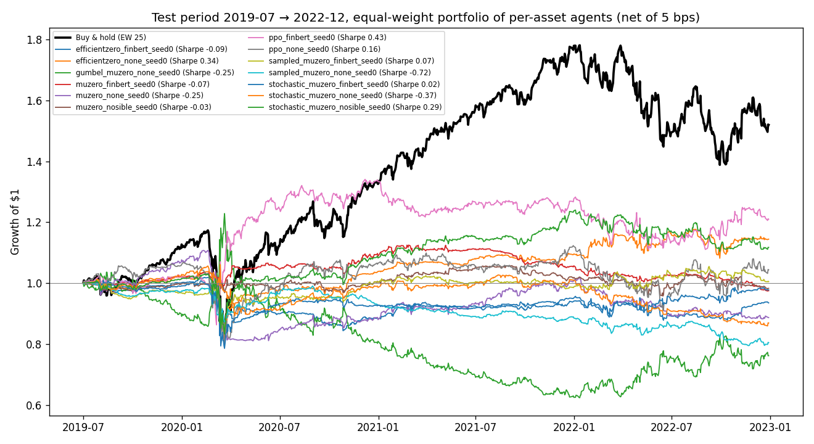

# MuTrading

**Can MuZero-style reinforcement learning, plus free news/forum sentiment, trade stocks better than buy-and-hold?**

**Short answer: no — not reliably.** One run did beat buy-and-hold, but it didn't hold up when repeated.

> Full methodology, every experiment and all tables: **[EXPERIMENTS.md](EXPERIMENTS.md)**



## What was tested

| | |
|---|---|
| **Algorithms** (via [LightZero](https://github.com/opendilab/LightZero)) | MuZero, EfficientZero, Gumbel MuZero, Stochastic MuZero, Sampled MuZero, UniZero (+ PPO as a non-MuZero comparison) |
| **Sentiment** (no paid APIs) | ~474k free news headlines and Reddit posts, scored with **FinBERT** and **NOSIBLE** (a 2025 LLM-based classifier) |
| **Assets** | 10 ETFs + 15 large-cap US stocks, daily bars |
| **Train / validation / test** | 2010–2017 / 2018 – mid-2019 / **Jul 2019 – Dec 2022** (COVID crash, 2021 rally, 2022 bear market) |
| **Variations** | with/without sentiment, long/short vs long-only, multiple random seeds |
| **Costs** | 5 bps per trade |

## Results (test period, equal-weight portfolio of all 25 assets)

| Strategy | Test Sharpe |
|---|---|
| Long when price is above its 200-day average (simple rule) | **0.91** |
| **Buy & hold** | **0.65** |
| Stochastic MuZero + NOSIBLE sentiment, long-only (average of 3 seeds) | 0.62 |
| PPO + FinBERT | 0.43 |
| UniZero + FinBERT | 0.41 |
| EfficientZero | 0.34 |
| UniZero, no sentiment | 0.09 |
| All other MuZero-family runs | −1.04 to +0.35 |

## Key findings

- **The one "winner" was luck.** Stochastic MuZero + NOSIBLE, long-only, seed 0 scored a Sharpe of **1.11** (13.2%/yr, −12% max drawdown vs buy-and-hold's −29%). Seeds 1 and 2 of the same setup scored **0.29** and **−0.47**. Averaged together it only matches buy-and-hold's Sharpe, at 4.8%/yr vs 12.7%, because it sits partly in cash.
- **Validation scores don't predict test results.** UniZero had the best validation score of any run (1.14) and then scored 0.09 on test. With 18 months of validation data, picking the "best" run is mostly picking noise.
- **MuZero-style planning doesn't help here.** MuZero shines when your actions change the world it is modelling. In trading, your action only changes your own position; the rest is next-day price moves, which are close to unpredictable.
- **News helps slightly; forums don't.** The sentiment signal is weak and flips direction between periods. NOSIBLE beat FinBERT by a small, repeatable margin. Reddit data is too sparse before 2017 to train on, so news was used instead.
- **Constraints mattered more than the algorithm.** Removing shorting and adding sentiment helped more than switching between MuZero variants.

## Potential improvements

**Experiments worth trying**
- Train on hundreds of stocks instead of 25 (more data, less overfitting).
- Let the agent trade a whole portfolio at once rather than one asset at a time.
- Reward risk-adjusted returns (e.g. differential Sharpe) rather than raw returns.
- Retrain periodically as time moves forward (walk-forward) instead of training once.
- Use a much longer validation period and select checkpoints across several seeds.

**Housekeeping**
- Delete leftover checkpoints on the Modal volume `rltrading-exp` (2.3 GB, ~$0.21/month).
- Delete local WSL data in `~/rlt` (~5 GB: raw news data and checkpoints).

## Project layout

```
rltrading/        data, sentiment, environment, training and backtest code
scripts/          sentiment IC analysis, summaries, plots, local job queue
modal_app.py      Modal jobs (GPU sentiment scoring, CPU training sweeps)
patches/          fixes applied to LightZero (4 bug fixes + ~2.5x faster CPU training)
data/processed/   daily sentiment features (committed)
results/          per-run metrics, summary tables, equity curves
EXPERIMENTS.md    detailed report: setup, every experiment, conclusions, engineering notes
```

## Reproduce

See [EXPERIMENTS.md → Reproduce](EXPERIMENTS.md#reproduce).

## Cost

$6.82 of Modal credit in total (GPU sentiment scoring + some parallel training); the rest ran on a local 8-core CPU.

## Data licences

Prices from Yahoo Finance. The news corpus ([financial-news-multisource](https://huggingface.co/datasets/Brianferrell787/financial-news-multisource)) is for research / non-commercial use only.
